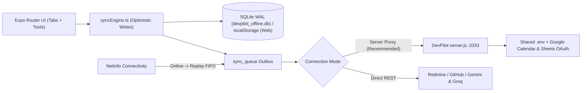

<div align="center">


# DevPilot Mobile

**Offline-first Android, iOS & Web companion for [PR-TO-Tracker (DevPilot)](https://github.com/Megharaj170804/PR-TO-Tracker)**

[](package.json)
[](package.json)
[](src/db/schema.ts)
[](docs/BUILD_AND_RELEASE.md)

</div>

---

DevPilot Mobile brings your full engineering workflow — **Redmine time logging, 30-day 8h audits, Google Calendar meetings, GitHub PR -> Redmine conversion, Work Hierarchy, EOD Google Sheets, PR Review comments, and KPI Reflections** — into a fast, animated-splash mobile app that keeps working offline and syncs automatically when connectivity returns.

---

## Key Capabilities

| Screen | What It Does | Works Offline |
| --- | --- | --- |
| **Today (Daily Workspace)** | 8h daily meter, 30-day weekday audit, Google Calendar meetings & Meet links, AI Standup/EOD composer | Cached audits, issues & standup drafting; time logs queue |
| **PR Sync** | Fetch GitHub PR commits/diffs, AI-generate Redmine fields, create linked issues | Reads `pr_cache`; queues `CREATE_ISSUE` |
| **Quick Task** | Instant Redmine task creation with presets (`0.5h–8h` chips) & AI note expansion | Queues `CREATE_QUICK_TASK` |
| **Work Hierarchy** | Collapsible Epic -> Story -> Task -> Bug tree, live status updates & activity feed | Reads cached tree; queues `UPDATE_ISSUE_STATUS` |
| **EOD Updates** | Multi-tab Google Sheets viewer, cell editor & new daily row entry | Edits queue via `SHEETS_*` ops |
| **PR Comments** | Turn GitHub PR review discussions into clean Redmine updates | Reads cached PRs |
| **KPI Reflection** | Periodic KPI note drafting persisted per period (`kpi_drafts`) | Fully persisted in SQLite |
| **Settings & About** | Server Proxy / Direct switch, Google OAuth setup, Outbox retry queue, Theme toggle & About | Full queue inspection |

---

## Offline + Live Server Sync Architecture



---

## Quick Start

### 1. Install Dependencies
```bash
git clone https://github.com/Megharaj170804/dev-pilot-mobile.git
cd dev-pilot-mobile
npm install
```

### 2. Run Locally
```bash
# Start Metro bundler (scan QR with Expo Go or press a/w)
npm start

# Run directly in browser
npm run web

# Run Android emulator/device
npm run android
```

### 3. Connect to DevPilot Web Server (Recommended)
1. Start the companion backend in [PR-TO-Tracker](https://github.com/Megharaj170804/PR-TO-Tracker): `npm start`.
2. Open **Settings -> Connection & Credentials** in DevPilot Mobile and pick **DevPilot Server Proxy**:
   - **Web (`localhost:8081`):** `http://localhost:3333`
   - **Physical Phone:** `http://<your-laptop-lan-ip>:3333`
3. Tap **Save & Test Connection** — Redmine, GitHub, AI keys, Google Calendar, and Google Sheets sync automatically.

---

## Build Android `.aab` / `.apk`

Preconfigured via `eas.json` (`net.tekdi.devpilot`):
```bash
# Cloud build signed Android App Bundle (.aab)
eas build --platform android --profile production

# Cloud build standalone APK (.apk) for direct installation
eas build --platform android --profile preview
```
See [docs/BUILD_AND_RELEASE.md](docs/BUILD_AND_RELEASE.md) for EAS setup and local Gradle (`./gradlew bundleRelease`) instructions.

---

## Documentation (`docs/`)

- [**Architecture Overview**](docs/ARCHITECTURE.md) — Navigation, modules, connection modes & SQLite concurrency mutex
- [**Features Guide**](docs/FEATURES.md) — Detailed walkthrough of all 7 screens + Settings & About
- [**Offline SQLite & Sync Queue**](docs/OFFLINE_SYNC.md) — 16-table schema, optimistic mutations & `sync_queue` replay
- [**Build & Android Release Guide**](docs/BUILD_AND_RELEASE.md) — `.aab` and `.apk` generation via EAS or local Gradle

---

## Verification

```bash
npm run typecheck
```
