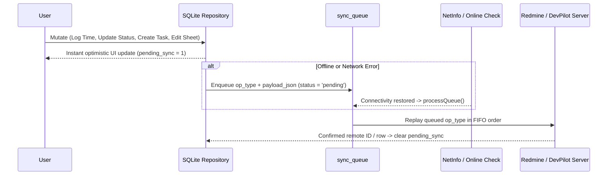

# Offline SQLite Schema & Sync Queue

DevPilot Mobile guarantees zero data loss during offline work by combining **WAL-mode SQLite persistence** with an **optimistic outbox queue (`sync_queue`)**.

---

## 1. Local Storage Adapters

| Platform | Implementation | Location |
| --- | --- | --- |
| **Android & iOS** | `expo-sqlite` (`devpilot_offline.db`, `PRAGMA journal_mode = WAL`, `PRAGMA foreign_keys = ON`) | `src/db/schema.ts`, `src/db/repositories.ts` |
| **Expo Web** | Browser `localStorage` table store | `src/db/schema.web.ts`, `src/db/repositories.web.ts` |
| **Credentials** | `expo-secure-store` (native) / `localStorage` (web) | `src/services/configService.ts` |

### Serialized Transaction Mutex
Every multi-statement write on native Android/iOS runs through `runInTransaction(fn)` in `src/db/schema.ts`, which chains transactions sequentially through `txChain` to eliminate `cannot start a transaction within a transaction` errors when background polling and user actions overlap.

---

## 2. SQLite Schema (`DB_SCHEMA_VERSION = 1`)

| Table | Primary Key / Index | Purpose |
| --- | --- | --- |
| `meta` | `key` | Stores sync timestamps, user metadata, and app state flags |
| `projects` | `id` | Cached Redmine projects (`issue_count`, `is_default`) |
| `project_members` | `(project_id, user_id)` | Assignable team members per project |
| `issue_statuses` | `id` | Redmine issue status catalog (`is_closed`) |
| `time_activities` | `id` | Redmine time activity types (`Development`, etc.) |
| `target_versions` | `id` | Project target versions / milestones |
| `issues` | `id` (+ indexes on `project_id`, `parent_id`) | Full synced Redmine issue hierarchy & custom fields |
| `time_entries` | `id` (+ index on `spent_on`) | Logged & optimistic (`pending_sync = 1`) time entries |
| `sync_history` | `id` (autoincrement) | History of created PR-linked & Quick Task issues |
| `pr_cache` | `pr_url` | Cached GitHub PR payloads (`repo`, `number`, `payload_json`) |
| `calendar_events` | `(id, date_str)` | Cached Google Calendar meetings & Meet metadata |
| `eod_sheet_tabs` | `gid` | Connected Google Sheet tabs |
| `eod_sheet_rows` | `(gid, row_num)` | Sheet cell matrices with `pending_sync` flag |
| `kpi_drafts` | `(period_key, kpi_id)` | Saved KPI reflection inputs and generated text |
| `activity_feed` | `id` (autoincrement) | Diff log of issue updates (`status`, `done_ratio`, etc.) |
| `sync_queue` | `id` (autoincrement) | Durable offline write outbox |

---

## 3. Outbox Replay Flow (`syncEngine.ts`)

### Supported Queue Operations (`op_type`)

1. `UPDATE_ISSUE_STATUS` — Updates Redmine issue status via `PUT`.
2. `LOG_TIME` — Submits time entry and replaces the temporary local entry via `TimeEntriesRepo.confirmRemote`.
3. `CREATE_ISSUE` — Creates a PR-linked Redmine issue and updates temporary negative IDs in `sync_history`.
4. `CREATE_QUICK_TASK` — Creates a Quick Task + optional time entry and updates `sync_history`.
5. `SHEETS_UPDATE_CELL` — Updates a modified Google Sheet cell.
6. `SHEETS_APPEND_ROW` — Appends a new EOD row to Google Sheets.
7. `SHEETS_DELETE_ROW` — Deletes an EOD row from Google Sheets.

Failed network items retry up to `MAX_SYNC_QUEUE_ATTEMPTS` (`5`) and remain visible in **Settings -> Offline Sync Queue** with `last_error` details until resolved or manually retried.
